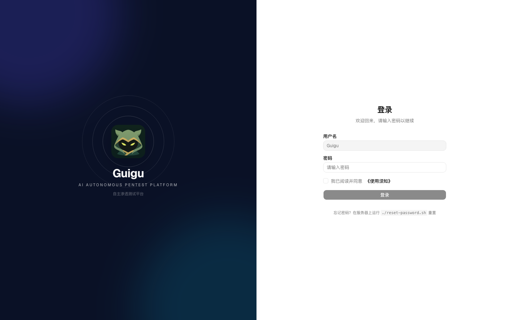

<div align="center">


# Guigu

**AI 自主渗透测试平台**

从侦察到报告交付，多智能体自主完成 · 全程可视化 · 可介入 · 可交付

[](LICENSE)
[](go.mod)
[](web/package.json)
[](CHANGELOG.md)



</div>

---

## 简介

Guigu 是一套 AI 自主渗透测试平台：给定授权目标，由规划器 / 工作者 / 主控多智能体围绕**双图架构**（全局资产图 + 每任务探索图）自主完成 侦察 → 攻击面发现 → 利用验证 → 漏洞记录 → 报告交付，全程可视化、可介入、可交付。

与多数「擅长发现、止于发现」的自动化渗透工具不同，Guigu 把重心放在**交付**——让 AI 挖到的漏洞，变成工程师看得懂、能复现、带证据、可直接交付客户的报告。

> ⚠️ 仅限合法授权、自有系统与隔离靶场。审核、拦截和人工确认只是辅助控制，不能替代授权边界、目标隔离与操作者判断。

## 核心特性

### 证据驱动的报告交付

不是「让 AI 写报告」，而是**让报告里每一步都可追溯到真实发生的事**：

- **复现过程就地落库** —— agent 在击穿当下逐字记录入口点 / 前置条件 / 有序步骤 / 来源，落库到 `findings.reproduction`。报告优先逐字渲染，AI 不得重建。这是「报告可信」与「报告像编的」的分界线。
- **每步绑定真实流量** —— 用「时间窗 + 步骤顺序」双约束把每一步映射到真实录制的 exchange，报告里可点进流量包逐字核对。判别器只在仍有多个候选时才施加，改写过的字段不会把匹配打成零。
- **确定性排版** —— AI 只写叙述，排版交给 python-docx：封面、自动目录、页码、每条漏洞的属性表与 7 个编号小节。产出的是 40KB+ 的真实 .docx，不是 Markdown 转贴。
- **骨架可编辑** —— 方法论 / 55 项测试清单 / 工具 / 规范 / 人员 投影到 `skills/report-generation/`，改完下次生效，逐文件回退默认。简繁英三语。

### 知识库（两层 RAG）

全局公共库（漏洞库 / 0day / 方法论 / 判定标准，跨任务复用）+ 任务专属资料（甲方接口文档 / 评分规则 / 授权范围，只对本任务可见）。

检索时全局永远可见、任务库只在所属任务内可见。**缺 pgvector 或未配 embedder 时自动降级为关键词检索**——功能不消失、启动不阻断；语义路径上的任何失败（供应商 5xx、超时、维度不匹配）都静默降到关键词，因为检索是 agent 的中途动作，不该因供应商抖动让整个任务失败。

### 代理池（多出口轮换）

agent 的所有扫描请求（curl / nmap / python 脚本 / WebFetch）经本地 MITM 转发，池非空时**按策略为每个请求选出口**——agent 侧无需任何改动。

- 四种策略：轮换（按权重）、按目标粘性、粘性首次随机、随机
- **失败占比淘汰**（而非连败次数）：一个「3 次失败 1 次成功」的出口最长连败只有 3，连败计数永远熔断不了它，但它拖慢了 75% 的请求；占比判定会把它降级。没有健康出口时仍兜底使用，避免从「慢」变成「完全不通」。
- 自动抓取公开清单源、并发验证、主动健康巡检、熔断自动恢复
- agent 侧提供 `proxy_status` / `proxy_report`，可主动上报「这个出口对我不好使」

### 角色分工

planner / worker / mainagent / 报告 可各自绑定不同的 LLM 配置。执行量大宜用便宜快的模型，报告只跑一次但要文笔——分开绑之后这种取舍就消失了。`profile_id=0` 表示跟随全局激活配置。

### 场景包（附加式）

场景是**追加层**，不是替换层：选中后把行业特定的判断口径、技能、禁用工具追加到通用 prompt 之上，通用能力不受影响。空场景时 system prompt 与变更前逐字节一致。

内置金融 / 支付场景（含硬性红线：只用自有账号、0.01 即停止、绝不修改收款人、绝不重放付款回调），也支持用户自建。

### 后渗透

MCP 一键导入模板（GodzillaSuper / Playwright / ScopeSentry）。模板只预填非敏感字段，密钥与会话信息一律留空由用户填写；创建后默认停用，避免指向错误地址的服务被自动拉起。

## 快速开始

### 方式一：Docker Compose（推荐）

```bash
git clone https://github.com/Banannna69/Guigu.git
cd Guigu
chmod +x deploy.sh && ./deploy.sh
```

首次运行自动生成权限 `0600` 的 `.env`（含随机 PostgreSQL 密码），已有 `.env` 不会被覆盖。

### 方式二：直接拉取镜像

```bash
docker pull ghcr.io/banannna69/guigu:latest
```

镜像支持 `linux/amd64` 与 `linux/arm64`。打 tag 时由 GitHub Actions 自动构建发布。

### 方式三：源码构建

```bash
# 需要 Go 1.26+、Node.js 20+
chmod +x build.sh && ./build.sh
export ARTEX_PG_DSN='postgres://guigu:密码@127.0.0.1:5432/guigu?sslmode=disable'
./dist/artex-linux-amd64/artex
```

### 首次使用

1. 浏览器访问 `http://<服务器IP>:8787/setup`，设置管理员密码（用户名固定为 `Guigu`）
2. 在 **系统 → LLM** 配置模型（Anthropic / OpenAI / 兼容 OpenAI 的私有网关均可）
3. 在 **系统 → 代理池** 按需配置出口（可选）
4. **任务 → 新建任务**：选择场景分类与 planner 模板，填写目标开跑

**忘记密码**：`./reset-password.sh -m docker -c <pg容器名> --exec docker -p '新密码'`

## 数据库

默认使用 **pgvector/pgvector:pg16** 镜像（而非官方 postgres）。知识库的语义检索需要 `CREATE EXTENSION vector`，官方镜像不带该扩展。pgvector 镜像是官方 postgres 加了扩展的等价替代，数据目录格式完全一致，可原地换镜像。

使用外部 PostgreSQL 且无法安装 pgvector 时，知识库自动降级为关键词检索。

## 技术架构

Go 单体后端（`go:embed` 内嵌 Next.js 前端）+ PostgreSQL。

核心是**双图架构**：全局共享的资产图（跨任务的资产真值库）与每任务独立的探索图（目标 / 意图 / 事实 / 漏洞的推进血缘链），两图靠锚点互连。引擎事件驱动——图一变就唤醒规划器派意图，工作者领意图执行并把结果写回，写回再触发下一轮，直到目标被证明。

流量子系统内嵌 go-mitmproxy，录制结果落 SQLite（contentless trigram FTS）+ blob 存储，支撑分页查询与正文检索。

## 相对基础版本的增强

| 方面 | 说明 |
| --- | --- |
| **证据驱动的交付** | 复现过程就地落库、每步绑定真实流量包、python-docx 确定性排版 |
| 知识库检索 | 全局 + 任务双层 RAG，缺 pgvector 自动降级关键词 |
| 代理池 | 多出口按策略轮换、失败占比淘汰、自动抓取与巡检 |
| 角色分工 | 四个角色分别绑定 LLM 配置，报告可单独用强模型 |
| 场景包 | 附加式行业增强，不替换通用能力 |
| 后渗透编排 | MCP 一键导入模板 + agent 可上报坏出口 |

## 致谢

本项目站在多个开源项目的肩膀上，此处明确说明各自借鉴了什么：

- **[ARTEX](https://github.com/Autumn-27/artex)**（[@Autumn-27](https://github.com/Autumn-27)）—— **技术基座**。探索图引擎、planner-worker 多智能体编排、MITM 流量录制、规则化 HITL 拦截、资产图谱，全部来自 ARTEX。Guigu 是在它之上的工程化与能力补齐。
- **[AntiFox](https://github.com/AntiFox-AI/antifox)** —— **报告交付管线**。整套「证据驱动交付」的设计思路（复现就地落库、步骤绑定流量、AI 叙述 + python-docx 排版、可编辑骨架三语投影）移植自 AntiFox；知识库的两层 RAG 设计、角色分工（各角色绑定不同 LLM 配置）、漏洞富化与证据截图链路同样借鉴于此。单文件报告渲染器 `pybuilder/report_builder.py` 直接沿用了它的实现。
- **[Pojun](https://github.com/chu0119/pojun)** —— **代理池**。多上游轮换、四种选择策略、熔断与主动健康巡检的骨架来自 Pojun 的 `traffic/pool.go` 与 `proxypool_api.go`；本项目的改动是把淘汰判据换成失败占比、补上自动抓取，并修掉了「全部探测失败会把整池熔断」的缺陷。
- **[ProxyCat](https://github.com/honmashironeko/ProxyCat)** —— **代理淘汰策略与抓取源**。用「滑动窗口失败占比」替代「连续失败次数」的判据取自 ProxyCat；公开代理清单的抓取思路同样参考了它的插件化设计。

感谢以上作者的开源工作。

## 许可与免责声明

本项目基于 **AGPL-3.0** 协议开源，详见 [LICENSE](LICENSE)。使用、修改与再分发（含以网络服务形式提供）须遵守该协议条款。

**Guigu 仅供个人学习、代码研究与本地技术验证使用，不得用于对任何线上系统或网站发起实际测试。**

### 允许使用范围

个人学习、代码研究、安全技术原理探讨，以及在自行搭建的本地隔离环境中进行技术验证。

### 禁止事项

- 严禁对任何网站、线上服务、他人或第三方所有的联网系统发起扫描、探测、利用或攻击（无论是否已获得授权）
- 严禁将本软件用于任何实际的渗透测试、攻防对抗、红蓝演练或生产环境
- 严禁用于非法入侵、数据窃取、勒索、拒绝服务或任何破坏性、犯罪性活动
- 严禁移除、篡改或规避本软件及其输出中的任何版权、许可或安全提示信息

### 合规责任

您应自行遵守所在国家或地区关于网络安全、数据安全与个人信息保护、计算机犯罪等方面的全部法律法规。因违反上述规定而产生的一切法律责任与后果，由您本人独立承担。

### 免责声明

本软件按「现状（AS IS）」与「现有（AS AVAILABLE）」状态提供，不附带任何明示或默示的担保。在适用法律允许的最大范围内，作者及贡献者不对因使用或无法使用本软件而导致的任何直接、间接、偶然、特殊或后果性损失承担责任。
